# LocalShop PWA

LocalShop es una práctica académica de comercio local construida con Spring Boot 3.5, Java 17 y renderizado SSR con Thymeleaf. El catálogo persiste en H2, puede instalarse como PWA, conserva la última vista para uso sin conexión y solicita geolocalización solo al pulsar el botón.

## Funcionalidades

- Catálogo SSR de seis productos desde JPA/H2.
- Diseño responsive sin dependencias CDN.
- Manifest e iconos PNG 192/512 para instalación.
- Service Worker: network-first para navegación y cache-first para estáticos.
- Fallback offline y limpieza de cachés antiguas.
- Geolocalización con manejo de permiso, timeout y posición no disponible.
- Pruebas unitarias/de integración y verificación continua.

## Requisitos y ejecución

- JDK 17 o posterior.
- Puerto 8080 disponible.

Windows:

```powershell
.\mvnw.cmd clean verify
.\mvnw.cmd spring-boot:run
```

Linux/macOS:

```bash
./mvnw clean verify
./mvnw spring-boot:run
```

Abrir `http://localhost:8080/`. La consola H2 está en `/h2-console`, con URL `jdbc:h2:file:./data/localshop`, usuario `sa` y contraseña vacía.

## Arquitectura

```text
controller/ProductoController -> repository/ProductoRepository -> H2
              |                              |
              +------ templates/index.html <-+

static/manifest.json + sw.js + css/ + js/ + images/
```

La página se renderiza en el servidor. Sin red, el navegador muestra el último HTML guardado; no consulta H2. `ddl-auto=update` se usa solo para esta práctica. El inicializador inserta seis productos únicamente si la tabla está vacía.

## Pruebas manuales

- [Flujo offline](docs/pruebas-offline.md)
- [Geolocalización](docs/pruebas-geolocalizacion.md)

### Evidencias reales

La vista de escritorio comprueba que el catálogo SSR presenta los seis productos, sus precios y la acción de ubicación con una distribución adecuada para pantallas amplias.

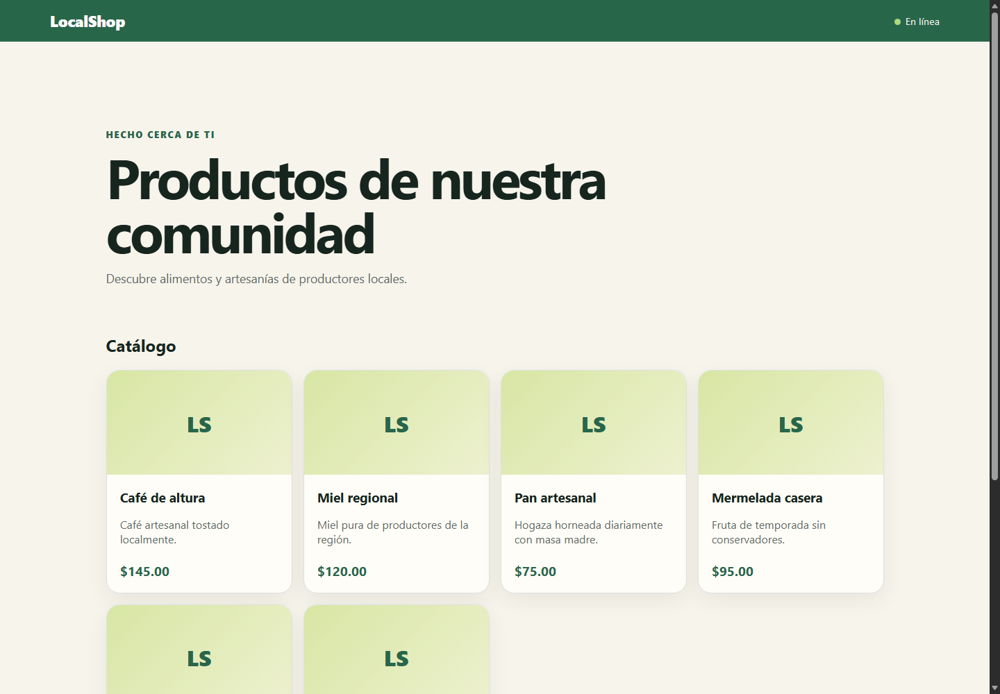

La vista móvil demuestra que el diseño es responsive: las tarjetas y controles se reorganizan sin provocar desplazamiento horizontal ni pérdida de contenido.

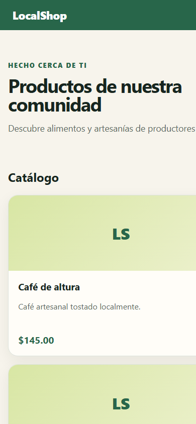

#### Manifest y recursos PWA

El navegador recibe correctamente `manifest.json` con el nombre, colores, modo de visualización e iconos requeridos para identificar LocalShop como PWA.

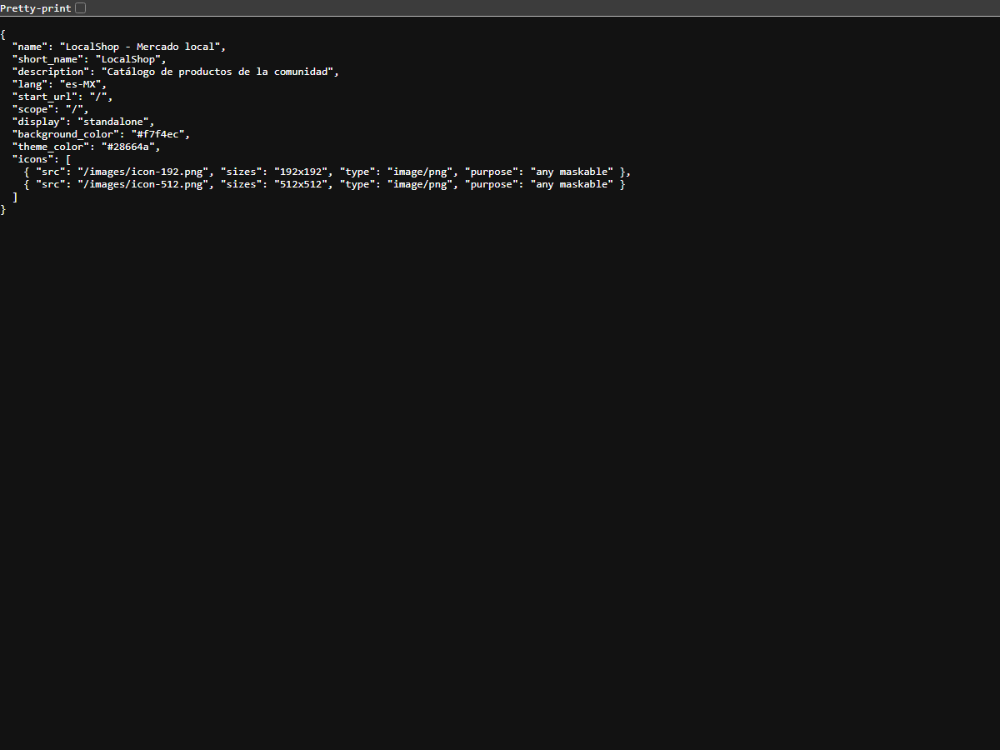

La ruta de respaldo ofrece una interfaz comprensible cuando no existe una respuesta de red ni una versión previa del catálogo en caché.

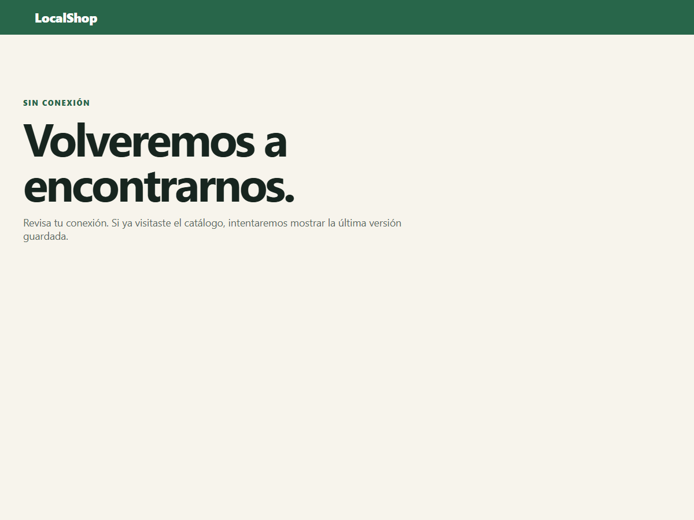

La consola de H2 confirma que la base de datos embebida está disponible durante el desarrollo para consultar la persistencia de los productos.

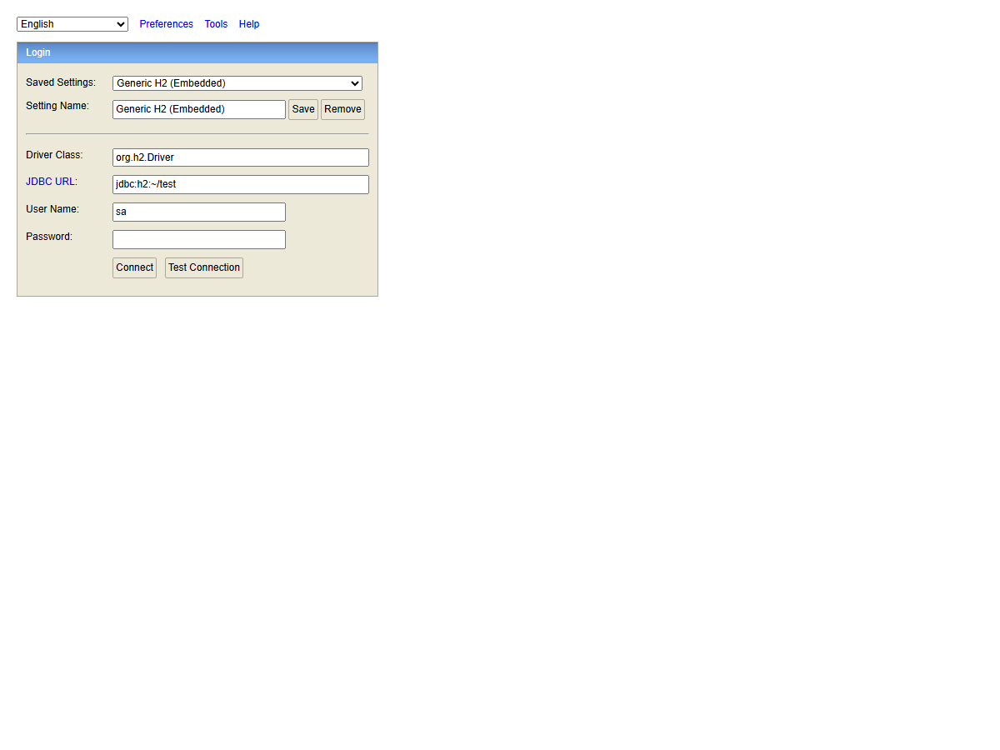

#### Validaciones manuales en Chrome

**Service Worker activo y controlando la página**

El panel Application de Chrome muestra que `sw.js` fue registrado, activado y se encuentra ejecutándose. Esto permite interceptar solicitudes y aplicar las estrategias de caché de la aplicación.

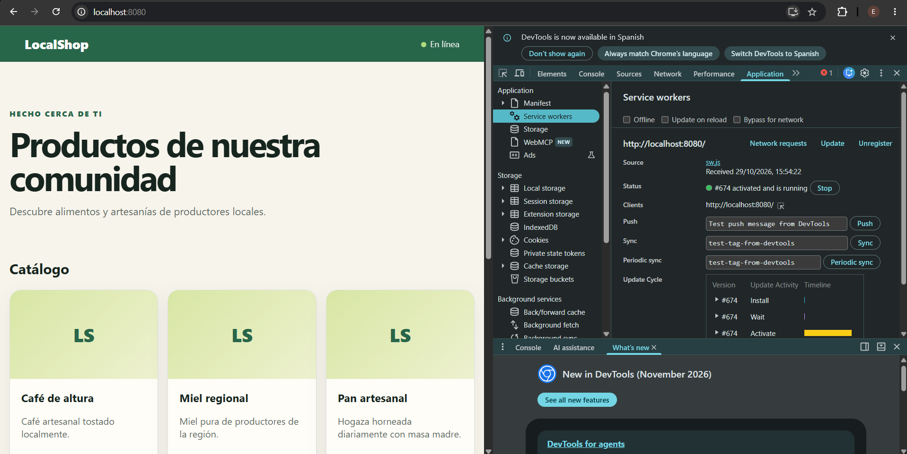

**Catálogo funcionando con Network > Offline**

Con la red deshabilitada desde DevTools, LocalShop continúa mostrando una experiencia navegable utilizando los recursos almacenados por el Service Worker.

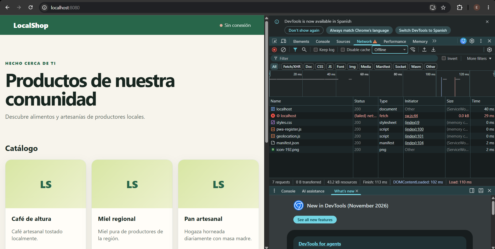

**Manifest reconocido e instalación disponible**

Chrome reconoce los metadatos y recursos necesarios para ofrecer la instalación. Las siguientes capturas muestran tanto la aplicación detectada como el diálogo de confirmación de instalación.

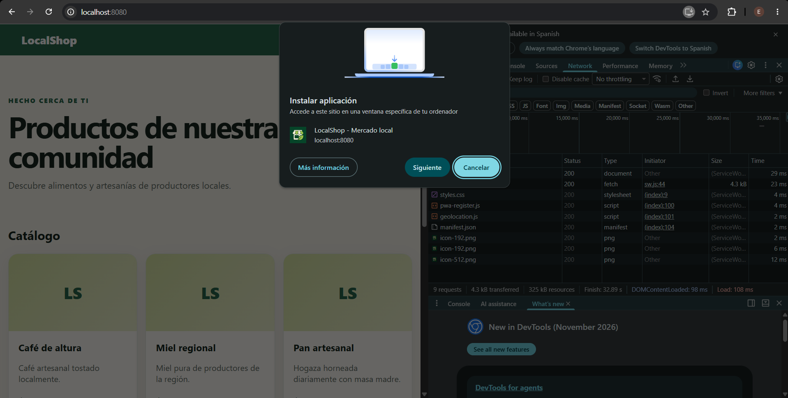

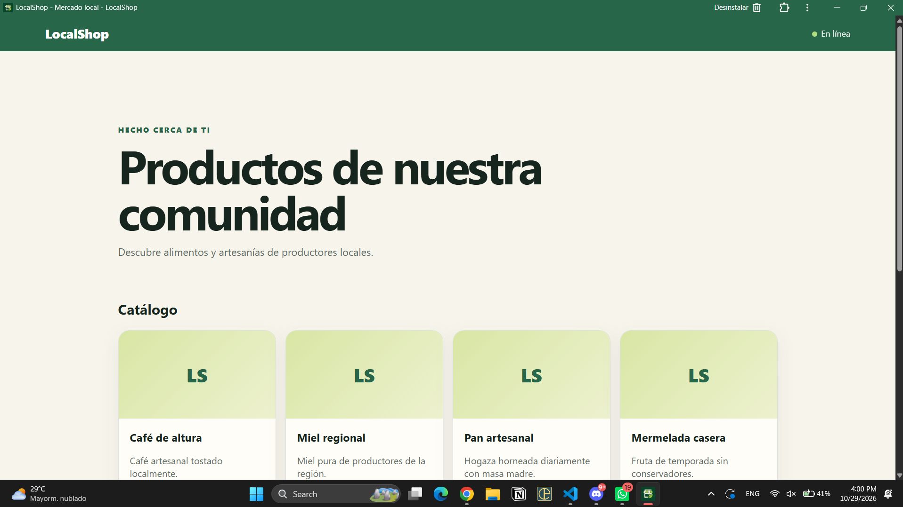

**Geolocalización permitida mostrando coordenadas**

Al conceder el permiso, la aplicación obtiene y presenta la ubicación únicamente después de la acción del usuario, sin enviarla ni guardarla en el servidor.

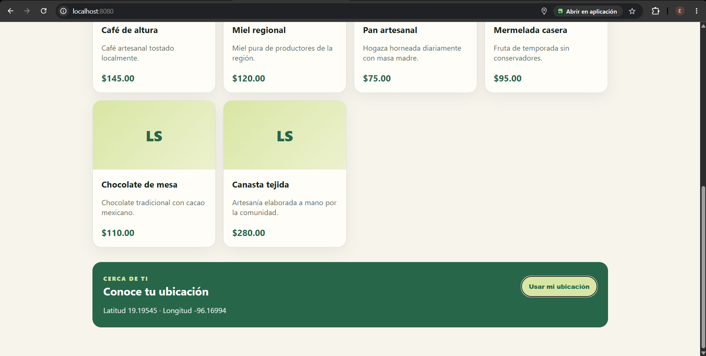

**Geolocalización denegada con mensaje controlado**

Al bloquear el permiso, la interfaz informa la situación de forma controlada y el resto del catálogo permanece funcional.

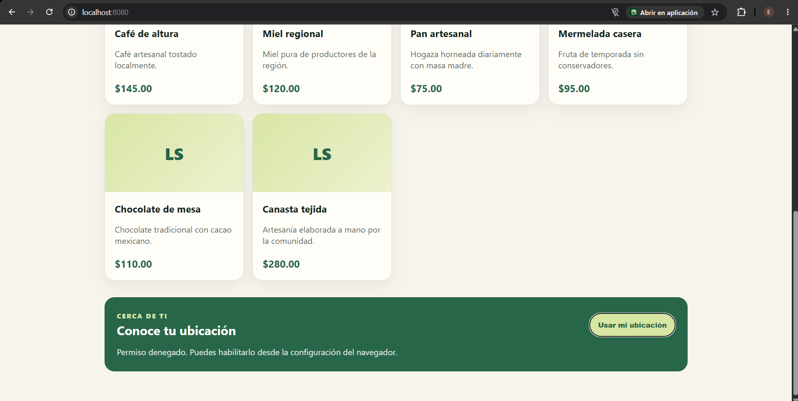

Para probar offline: visitar la página, recargar tras activar el Service Worker, seleccionar Offline en DevTools y volver a cargar. La geolocalización funciona en `localhost` o HTTPS y nunca se persiste ni se envía al servidor.

## Desarrollo por fases

| Fase | Cuenta | Aporte |
|---|---|---|
| Backend | [aceves08](https://github.com/aceves08) | Producto, JPA, H2 y datos iniciales |
| SSR | [JudithHP](https://github.com/JudithHP) | Controlador, Thymeleaf y diseño |
| App Shell | [Kilver15](https://github.com/Kilver15) | Manifest, iconos y registro PWA |
| Offline | [Emmanuel-Rochin](https://github.com/Emmanuel-Rochin) | Service Worker y caché |
| Integración | [JessErfi](https://github.com/JessErfi) | Geolocalización, QA, CI y documentación |

### Autores

- Jesús Eduardo Aceves Aguirre — [aceves08](https://github.com/aceves08)
- Judith Estefanía Hernández Pérez— [JudithHP](https://github.com/JudithHP)
- José Iván Solorio Serna — [Kilver15](https://github.com/Kilver15)
- Emmanuel Ulises Rochín Vargas — [Emmanuel-Rochin](https://github.com/Emmanuel-Rochin)
- Jesús Ernesto Fierro Sandoval — [JessErfi](https://github.com/JessErfi)

Las ramas se integran en `develop` mediante merge commit; la entrega se promueve de `develop` a `main`.

## Limitaciones

- La instalación, los permisos y el modo offline dependen de las capacidades y configuración del navegador.
- Offline presenta el HTML SSR cacheado; no ofrece operaciones de base de datos desconectadas.
- No incluye autenticación, carrito, pagos ni API REST.
